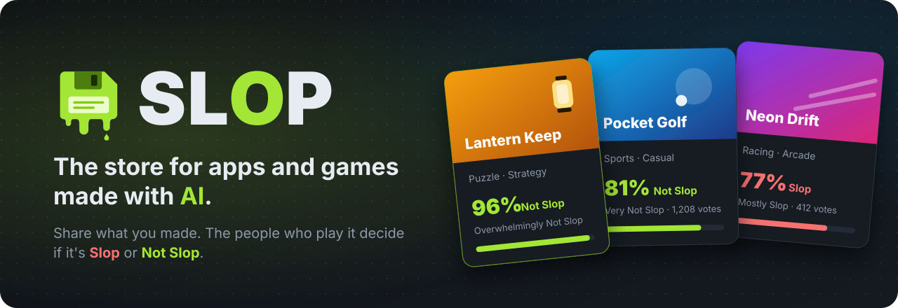
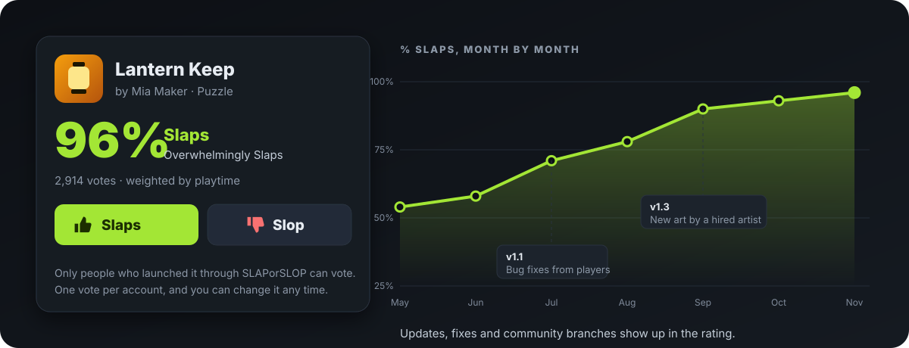
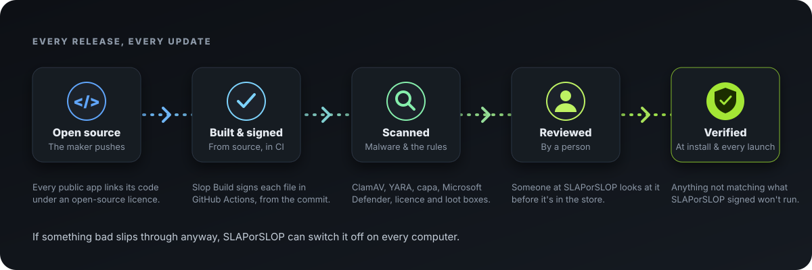

  

  
  
  
  

  <a href="https://slaporslop.games"><b>slaporslop.games</b></a> ·
  <a href="https://slaporslop.games/publish/guide">Publish your app</a> ·
  <a href="docs/DESIGN.md">How it works</a> ·
  <a href="docs/DEVELOPING.md">Developing</a>

 

## Why SLAPorSLOP exists

AI lets anyone make an app or a game in an afternoon. That's wonderful, and it's also why so much
of what gets made is slop.

**SLAPorSLOP is a place for AI slop developers and vibe coders to share their creations with the
world, and for everyone else to rate them on their thoroughness, thoughtfulness, artistic value
and overall craftsmanship.** Nothing is hidden for being made with AI, and nothing gets a pass for
it either. Some of it is slop. Some of it is wonderful. The players decide which.

 

## 👍 Slaps or 👎 Slop?

Every app on SLAPorSLOP has one honest number. Only people who actually launched it can vote, one vote
per account, weighted by how long they played, so a rating can't be bought or botted. Each store
page shows how that number changed over time, so you can see a project get better with every
update, fix and community branch.

  

 

## 🛡️ Checked before it reaches you

Every app is open source, and every release is built from that source, scanned, and looked at by
a person before anyone can install it. The SLAPorSLOP app then checks every file against what SLAPorSLOP
approved, when it installs and every time it starts. Free to download, always: no prices, no
in-app purchases, no loot boxes.

  

 

## 🛠️ Made something? Put it on SLAPorSLOP

Link your repository and accept one ready-made pipeline file: **Slop Build** builds, signs and
checks every release for you. Launch a *Coming soon* page before it's done, see who's
*Interested*, read real bug reports and reviews, and let players fork it to fix, mod and port it.
Players can donate, straight into your own Stripe account; SLAPorSLOP takes a flat 5% and never holds
your money.

**[Read the publishing guide →](https://slaporslop.games/publish/guide)**

 

## Where it's at

SLAPorSLOP is in **private testing** at [slaporslop.games](https://slaporslop.games). The desktop app runs on
Windows and Linux and updates itself; macOS and phones come later.

How SLAPorSLOP's Windows app is built and signed: [Code signing policy](docs/CODE-SIGNING.md).

Want to help build it? Start with [`docs/DEVELOPING.md`](docs/DEVELOPING.md),
[`CONTRIBUTING.md`](CONTRIBUTING.md) and [`AGENTS.md`](AGENTS.md). Found a security problem?
See [`CONTRIBUTING.md`](CONTRIBUTING.md#security-problems), and please don't open a public issue.
Anything else: [slopaigames@outlook.com](mailto:slopaigames@outlook.com).

## License

Copyright © 2026 IronPoint Development LLC.

SLAPorSLOP is open source under two licences, so improvements to the service stay open while code that
makers and other stores build on stays free to use in anything:

| Part | Licence |
|---|---|
| The server (`crates/slop-api`), the website (`web/`), the desktop app (`crates/slop-desktop`, `crates/slop-client`), and the deployment and development scripts (`deploy/`, `dev/`) | [GNU Affero General Public License v3.0 or later](LICENSE-AGPL) |
| Everything else, including the manifest and provenance crates (`crates/slop-manifest`, `crates/slop-provenance`), the engine snippets and examples (`examples/`), the build and check recipes (`slop-build/`), the docs and the mockup | [Apache License, Version 2.0](LICENSE-APACHE) or [MIT license](LICENSE-MIT), at your option |

The AGPL means anyone who runs a changed version of SLAPorSLOP's server or website for others must offer
those users its source code. Code from the second group never brings the AGPL into your own game
or store: the snippets, the recipes and the manifest checker are yours to copy.

Unless you explicitly state otherwise, any contribution you intentionally submit for inclusion in
this project is licensed as the part it changes is licensed above, without any additional terms or
conditions. See [CONTRIBUTING.md](CONTRIBUTING.md).
